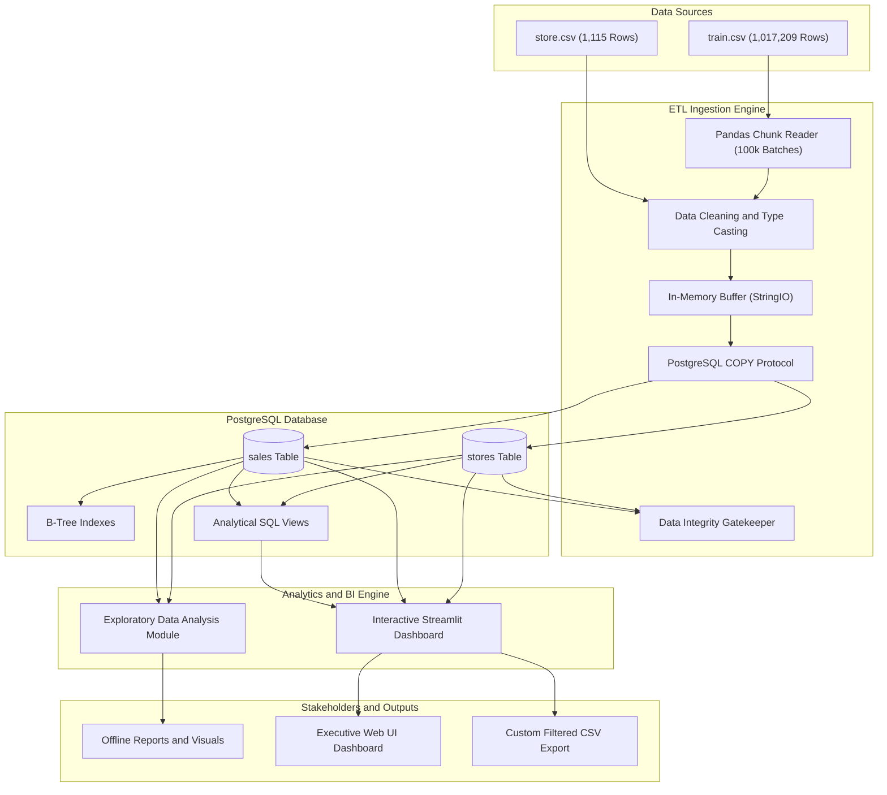
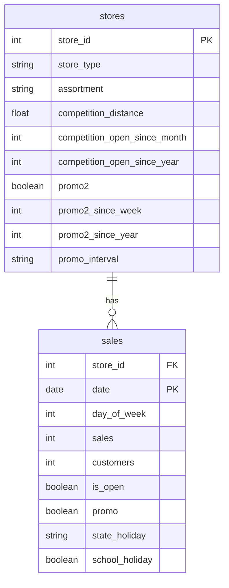
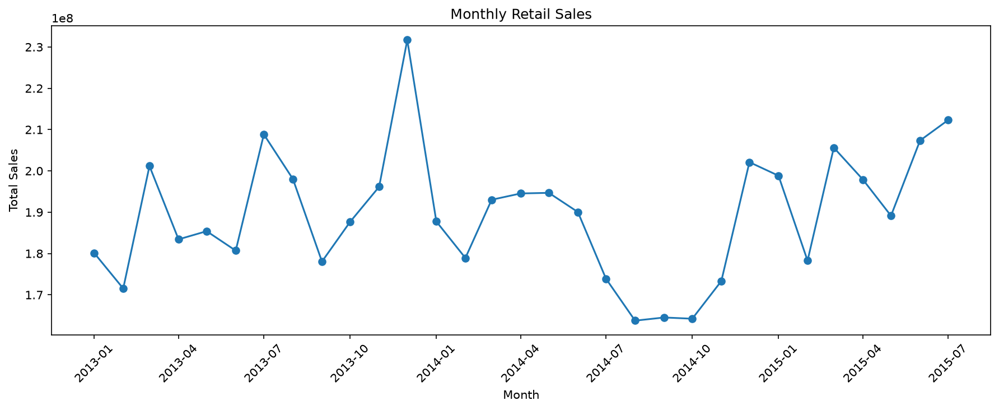
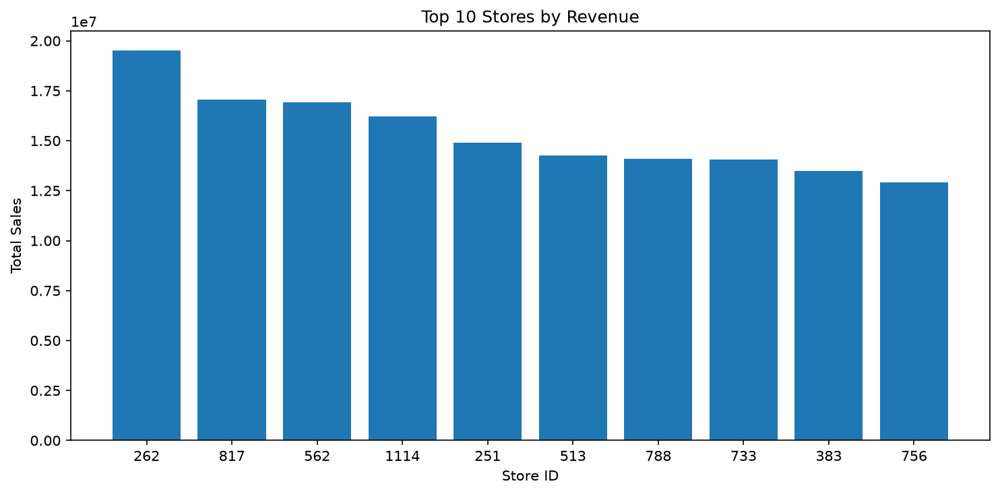
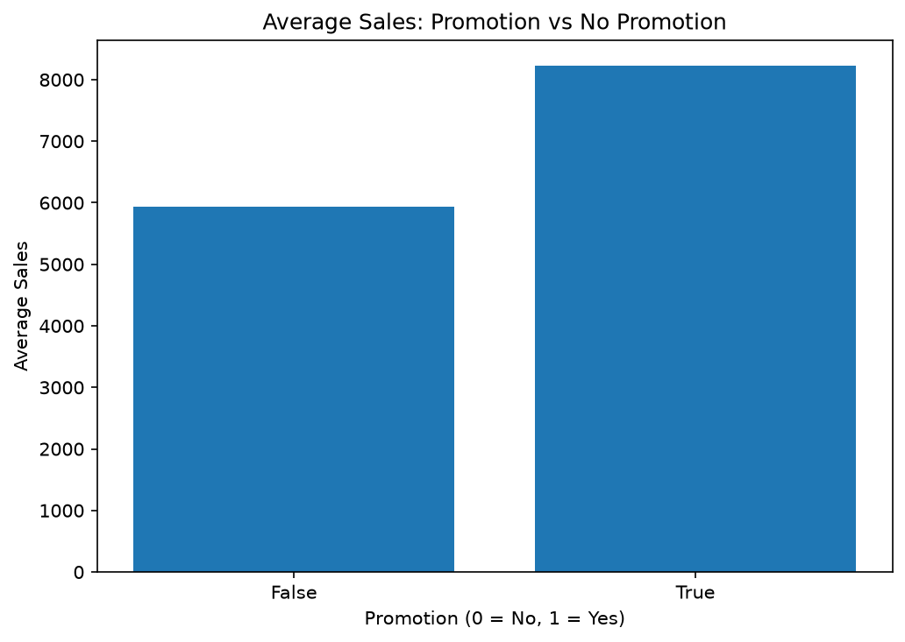
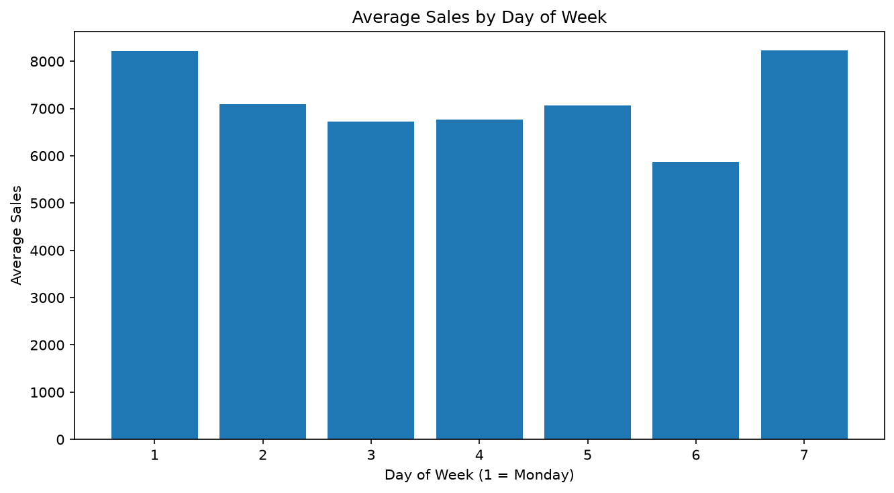
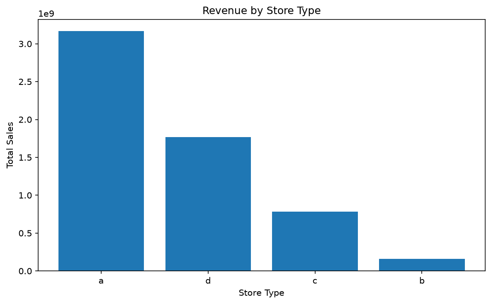

# 🛒 Retail Analytics Platform

[](https://www.python.org/)
[](https://www.postgresql.org/)
[](https://streamlit.io/)
[](https://plotly.com/)
[](https://pandas.pydata.org/)
[](https://opensource.org/licenses/MIT)

> **An end-to-end enterprise retail intelligence system** that ingests over 1 million transaction records, optimizes relational storage in PostgreSQL, executes advanced SQL analytical modeling, and serves dynamic executive business intelligence dashboards via Streamlit and Plotly.

---

## 📑 Table of Contents

- [1. Project Overview](#1-project-overview)
- [2. Problem Statement & Objectives](#2-problem-statement--objectives)
- [3. Technology Stack](#3-technology-stack)
- [4. Dataset Description & Provenance](#4-dataset-description--provenance)
- [5. System Architecture](#5-system-architecture)
- [6. Project Folder Structure](#6-project-folder-structure)
- [7. High-Throughput ETL Pipeline](#7-high-throughput-etl-pipeline)
- [8. PostgreSQL Database Schema](#8-postgresql-database-schema)
- [9. Analytical SQL Views & Verification](#9-analytical-sql-views--verification)
- [10. Exploratory Data Analysis (EDA)](#10-exploratory-data-analysis-eda)
- [11. Interactive Streamlit Dashboard](#11-interactive-streamlit-dashboard)
- [12. Key Performance Indicators (KPIs)](#12-key-performance-indicators-kpis)
- [13. Visualizations & Analytical Charts](#13-visualizations--analytical-charts)
- [14. Visual Gallery & Screenshots](#14-visual-gallery--screenshots)
- [15. Installation & Setup Guide (Windows-Friendly)](#15-installation--setup-guide-windows-friendly)
- [16. PostgreSQL Database Configuration](#16-postgresql-database-configuration)
- [17. Environment Variables Configuration](#17-environment-variables-configuration)
- [18. ETL Pipeline Execution](#18-etl-pipeline-execution)
- [19. Exploratory Data Analysis Execution](#19-exploratory-data-analysis-execution)
- [20. Dashboard Launch Instructions](#20-dashboard-launch-instructions)
- [21. Generated Reports & Data Artifacts](#21-generated-reports--data-artifacts)
- [22. Future Enhancements & Roadmap](#22-future-enhancements--roadmap)
- [23. Author & Connect](#23-author--connect)

---

## 1. Project Overview

The **Retail Analytics Platform** is a production-grade data engineering and business intelligence solution designed to extract actionable insights from multi-store retail transaction environments. Using historical data from over **1,115 retail stores** across **1,017,209 daily sales transactions**, the platform processes raw operational records, enforces relational integrity, indexes high-volume tables for analytical query performance, and serves an interactive web dashboard for store managers, financial analysts, and corporate leadership.

The solution encompasses:
- **Chunked In-Memory ETL Processing**: Ingestion of over 1M records in under 30 seconds using PostgreSQL binary stream buffers (`copy_expert`) and Pandas.
- **Relational Data Modeling**: Strict primary/foreign key constraints and composite indexes (`(store_id, date)`) in PostgreSQL.
- **Window Function Analytics**: Month-over-month growth rates, store revenue rankings, promotional sales lift, customer traffic trends, and store-type contribution shares.
- **Interactive Multi-Dimensional Dashboard**: Dynamic Streamlit UI with multi-select filtering, cohort analysis, period-over-period growth metrics, and instant filtered CSV data export.

---

## 2. Problem Statement & Objectives

### The Business Challenge
Retail chain operators manage hundreds of store locations with disparate traffic patterns, assortment tiers, seasonal demand spikes, and promotional campaigns. Without a centralized, high-performance analytical pipeline:
1. **Data Ingestion Bottlenecks**: Bulk transaction logs (millions of rows) fail to load efficiently or time out in standard relational databases.
2. **Delayed Performance Tracking**: Store performance discrepancies and regional trends remain hidden behind sluggish ad-hoc spreadsheets.
3. **Unquantified Promotion Returns**: Marketing teams struggle to measure empirical sales lift generated by promotional campaigns versus baseline organic traffic.
4. **Sub-optimal Assortment Allocation**: Different store models (`a`, `b`, `c`, `d`) perform heterogeneously, requiring localized assortment planning.

### Project Objectives
- [x] **Scalable Data Ingestion**: Engineer a resilient ETL pipeline capable of loading million-row datasets into PostgreSQL with automated validation.
- [x] **Analytical Data Modeling**: Formulate modular SQL views leveraging advanced window functions (`LAG`, `RANK`, `OVER`) for business metric calculation.
- [x] **Executive Visibility**: Construct a zero-latency, filterable Streamlit dashboard providing immediate visibility into revenue, footfall, and campaign ROI.
- [x] **Exportable Intelligence**: Enable business stakeholders to filter cohorts across date ranges, store types, and promotional states, downloading custom extracts for localized reporting.

---

## 3. Technology Stack

| Layer | Technology | Version | Purpose |
| :--- | :--- | :--- | :--- |
| **Language** | Python | `3.10+` | Core programming language for ETL, EDA, and UI serving |
| **Database** | PostgreSQL | `14+` | Enterprise relational database management system |
| **Database Driver** | Psycopg2 | `2.9+` | Low-level, high-performance PostgreSQL adapter for Python |
| **Data Processing** | Pandas | `2.0+` | Vectorized data manipulation, type coercion, and chunk streaming |
| **Dashboard Framework** | Streamlit | `1.30+` | Real-time web application framework for data science applications |
| **Visualizations** | Plotly Express | `5.18+` | Interactive, responsive web charts (lines, bars, heatmaps, donuts) |
| **Static Analytics** | Matplotlib & Seaborn | `3.8+` | Publication-ready visual figure generation for offline reports |
| **Configuration** | Python-Dotenv | `1.0+` | Secure runtime environment variable management |

---

## 4. Dataset Description & Provenance

The platform leverages the benchmark **Rossmann Store Sales** dataset (originating from the Kaggle competition). The dataset encompasses operational metrics from 1,115 drug stores across Europe between **January 1, 2013 and July 31, 2015**.

### Primary Files
1. **`train.csv` (1,017,209 records)**: Daily transaction logs per store, capturing revenue, customer footfall, open status, promotional flags, and calendar holiday flags.
2. **`store.csv` (1,115 records)**: Dimensional metadata per store, including store classification model, product assortment level, distance to nearest competitor, competitor opening dates, and recurring promotion schedules.

### Dataset Schema Summary

```
================================================================================
                      DATASET ATTRIBUTES & TYPES
================================================================================
stores (1,115 rows):
  ├── store_id                      INTEGER (PK)
  ├── store_type                    VARCHAR(10) ['a', 'b', 'c', 'd']
  ├── assortment                    VARCHAR(10) ['a' = Basic, 'b' = Extra, 'c' = Extended]
  ├── competition_distance          DOUBLE PRECISION (Meters)
  ├── competition_open_since_month  INTEGER [1 - 12]
  ├── competition_open_since_year   INTEGER [YYYY]
  ├── promo2                        BOOLEAN [0 = Inactive, 1 = Active]
  ├── promo2_since_week             INTEGER [1 - 52]
  ├── promo2_since_year             INTEGER [YYYY]
  └── promo_interval                VARCHAR(100) (e.g., 'Jan,Apr,Jul,Oct')

sales (1,017,209 rows):
  ├── store_id                      INTEGER (FK -> stores.store_id)
  ├── date                          DATE [2013-01-01 to 2015-07-31]
  ├── day_of_week                   SMALLINT [1 = Monday ... 7 = Sunday]
  ├── sales                         INTEGER (Daily Revenue in EUR)
  ├── customers                     INTEGER (Daily Customer Count)
  ├── is_open                       BOOLEAN [0 = Closed, 1 = Open]
  ├── promo                         BOOLEAN [0 = Inactive, 1 = Active Promo]
  ├── state_holiday                 VARCHAR(1) ['0' = None, 'a' = Public, 'b' = Easter, 'c' = Christmas]
  └── school_holiday                BOOLEAN [0 = Regular, 1 = School Holiday]
================================================================================
```

> [!NOTE]
> **Data Governance & Terms**: The raw Rossmann Store Sales dataset is subject to its original Kaggle competition rules and terms of use. Users must download raw data files directly from Kaggle and place them into the local `dataset/` directory. Raw data files are strictly excluded from version control via `.gitignore`.

---

## 5. System Architecture



---

## 6. Project Folder Structure

```
retail-analytics-platform/
├── .env.example                       # Template for database credentials & host port
├── .gitignore                         # Excludes .env, .venv/, __pycache__, and dataset/*.csv
├── requirements.txt                   # Project dependency manifest
├── README.md                          # Technical architecture & portfolio documentation
├── backend/
│   ├── analysis/
│   │   └── eda.py                     # Automated EDA script generating summary CSVs and charts
│   ├── dashboard/
│   │   └── app.py                     # Streamlit web application with interactive Plotly visuals
│   ├── etl/
│   │   └── load_data.py               # High-throughput COPY-based PostgreSQL ingestion pipeline
│   └── sql/
│       ├── schema.sql                 # DDL: Base tables, primary/foreign keys, and indexes
│       ├── analytics.sql              # Foundational analytical view declarations
│       └── advanced_analytics.sql     # Advanced SQL views: Window functions, LAG, RANK, lift
├── dataset/                           # Local directory for raw Kaggle data files
│   ├── store.csv                      # (Local only, gitignored)
│   └── train.csv                      # (Local only, gitignored)
├── docs/
│   ├── eda_outputs/
│   │   └── monthly_sales.csv          # Sample historical monthly revenue extract
│   └── screenshots/                   # Directory reserved for dashboard UI captures
└── reports/
    └── eda/                           # Artifacts produced by backend/analysis/eda.py
        ├── business_overview.csv      # Executive aggregate summary metrics
        ├── holiday_analysis.csv       # Revenue & customer metrics by holiday category
        ├── monthly_sales.csv          # Longitudinal monthly sales aggregation
        ├── monthly_sales.png          # Monthly revenue line chart
        ├── promotion_analysis.csv     # Promo vs non-promo performance split
        ├── promotion_analysis.png     # Promo impact comparative bar chart
        ├── store_type_analysis.csv    # Performance breakdown across store tiers a, b, c, d
        ├── store_type_analysis.png    # Store type revenue comparative chart
        ├── top_10_stores.csv          # Top 10 revenue-generating stores
        ├── top_10_stores.png          # Top 10 stores bar chart
        ├── weekday_analysis.csv       # Monday-Sunday sales & customer breakdown
        └── weekday_analysis.png       # Weekday sales distribution bar chart
```

---

## 7. High-Throughput ETL Pipeline

The ETL pipeline (`backend/etl/load_data.py`) is engineered to handle large volume transactions with maximum throughput and complete data consistency.

### Architectural Highlights
1. **PostgreSQL Binary Stream Protocol (`COPY ... FROM STDIN`)**:
   Standard row-by-row `INSERT` operations take 15–20 minutes to process 1M+ rows. By utilizing `psycopg2`'s `copy_expert` coupled with in-memory `io.StringIO` buffers, records are streamed directly into PostgreSQL internals, completing the 1,017,209-record load in **under 30 seconds**.
2. **Chunked Memory Management**:
   The sales dataset is consumed in configurable batches of `100,000` rows (`CHUNK_SIZE = 100_000`), guaranteeing that system memory remains predictable regardless of file size.
3. **Data Cleansing & Transformation**:
   - Snake-case normalization of all PascalCase column names.
   - ISO-8601 date string parsing (`YYYY-MM-DD`).
   - Nullable integer handling using Pandas `Int64` type to prevent float conversion of integer IDs (`competition_open_since_year`, `promo2_since_year`).
   - Boolean normalization (`is_open`, `promo`, `school_holiday`, `promo2`).
   - State holiday normalization ensuring string preservation (`'0'`, `'a'`, `'b'`, `'c'`).
4. **Automated Post-Load Integrity Gatekeeper**:
   Before committing, the pipeline executes an automated validation suite that verifies:
   - Exactly **1,115** stores loaded.
   - Exactly **1,017,209** sales records loaded.
   - Zero negative sales values (`sales < 0`).
   - Zero foreign key orphan records (`sales` missing a matching `stores` entry).

---

## 8. PostgreSQL Database Schema

The database design implements a 3rd Normal Form (3NF) relational star-like schema optimized for fast analytical aggregations.



### Table Definitions & Constraints

#### 1. `stores` Table
```sql
CREATE TABLE IF NOT EXISTS stores (
    store_id INTEGER PRIMARY KEY,
    store_type VARCHAR(10),
    assortment VARCHAR(10),
    competition_distance DOUBLE PRECISION,
    competition_open_since_month INTEGER,
    competition_open_since_year INTEGER,
    promo2 BOOLEAN,
    promo2_since_week INTEGER,
    promo2_since_year INTEGER,
    promo_interval VARCHAR(100)
);
```

#### 2. `sales` Table
```sql
CREATE TABLE IF NOT EXISTS sales (
    store_id INTEGER NOT NULL,
    date DATE NOT NULL,
    day_of_week SMALLINT,
    sales INTEGER,
    customers INTEGER,
    is_open BOOLEAN,
    promo BOOLEAN,
    state_holiday VARCHAR(1),
    school_holiday BOOLEAN,

    PRIMARY KEY (store_id, date),

    CONSTRAINT fk_sales_store
        FOREIGN KEY (store_id)
        REFERENCES stores(store_id)
);
```

#### 3. Analytical B-Tree Indexes
To ensure sub-second analytical query execution across 1M+ rows:
```sql
CREATE INDEX IF NOT EXISTS idx_sales_date ON sales(date);
CREATE INDEX IF NOT EXISTS idx_sales_store ON sales(store_id);
CREATE INDEX IF NOT EXISTS idx_sales_promo ON sales(promo);
```

---

## 9. Analytical SQL Views & Verification

The platform architecture is designed around **13 analytical SQL views** divided into foundational aggregations and advanced window calculations.

### Verification Audit of Repository SQL Scripts

> [!WARNING]
> **SQL Script Audit Status**:
> An inspection of the codebase indicates that **6 advanced analytical views** are fully defined and committed in `backend/sql/advanced_analytics.sql`. However, `backend/sql/analytics.sql` is currently **0 bytes (empty)** in the repository commit.
>
> Because views 3 and 5 in `advanced_analytics.sql` depend on `vw_store_performance` and `vw_store_type_analysis`, executing `advanced_analytics.sql` against a clean database requires creating those foundational views first.

### Group A: Advanced Analytical Views (`backend/sql/advanced_analytics.sql`)

#### 1. Month-over-Month Revenue Growth (`vw_revenue_growth`)
Calculates monthly sales totals alongside the prior month's revenue and the percentage growth using the `LAG()` window function.
```sql
CREATE OR REPLACE VIEW vw_revenue_growth AS
WITH monthly AS (
    SELECT
        DATE_TRUNC('month', date)::DATE AS month,
        SUM(sales) AS revenue
    FROM sales
    WHERE is_open = TRUE
    GROUP BY DATE_TRUNC('month', date)
)
SELECT
    month,
    revenue,
    LAG(revenue) OVER (ORDER BY month) AS previous_month_revenue,
    ROUND(
        100.0 * (revenue - LAG(revenue) OVER (ORDER BY month)) /
        NULLIF(LAG(revenue) OVER (ORDER BY month), 0),
        2
    ) AS growth_percentage
FROM monthly;
```

#### 2. Customer Spending Analysis (`vw_customer_spending`)
Measures average basket size and spending efficiency (revenue per customer) per store.
```sql
CREATE OR REPLACE VIEW vw_customer_spending AS
SELECT
    store_id,
    SUM(sales) AS total_revenue,
    SUM(customers) AS total_customers,
    ROUND(SUM(sales)::NUMERIC / NULLIF(SUM(customers), 0), 2) AS revenue_per_customer
FROM sales
WHERE is_open = TRUE
GROUP BY store_id;
```

#### 3. Store Revenue Ranking (`vw_store_ranking`)
Applies the `RANK()` window function across total store revenue. *(Depends on `vw_store_performance`)*.
```sql
CREATE OR REPLACE VIEW vw_store_ranking AS
SELECT
    store_id,
    store_type,
    total_revenue,
    RANK() OVER (ORDER BY total_revenue DESC) AS revenue_rank
FROM vw_store_performance;
```

#### 4. Promotion Revenue Lift (`vw_promotion_lift`)
Computes the empirical percentage revenue lift achieved on promotional days compared to non-promotional days across all open stores.
```sql
CREATE OR REPLACE VIEW vw_promotion_lift AS
WITH promotion_data AS (
    SELECT
        promo,
        AVG(sales) AS average_sales
    FROM sales
    WHERE is_open = TRUE
    GROUP BY promo
)
SELECT
    MAX(CASE WHEN promo = TRUE THEN average_sales END) AS promo_average_sales,
    MAX(CASE WHEN promo = FALSE THEN average_sales END) AS non_promo_average_sales,
    ROUND(
        100.0 * (
            MAX(CASE WHEN promo = TRUE THEN average_sales END) -
            MAX(CASE WHEN promo = FALSE THEN average_sales END)
        ) / NULLIF(MAX(CASE WHEN promo = FALSE THEN average_sales END), 0),
        2
    ) AS promotion_lift_percentage
FROM promotion_data;
```

#### 5. Store Type Revenue Contribution (`vw_store_type_contribution`)
Evaluates the revenue contribution percentage of each store model (`a`, `b`, `c`, `d`) relative to the entire retail network using `SUM() OVER ()`. *(Depends on `vw_store_type_analysis`)*.
```sql
CREATE OR REPLACE VIEW vw_store_type_contribution AS
SELECT
    store_type,
    total_revenue,
    ROUND(
        100.0 * total_revenue / NULLIF(SUM(total_revenue) OVER (), 0),
        2
    ) AS revenue_contribution_percentage
FROM vw_store_type_analysis;
```

#### 6. Monthly Customer Footfall Traffic (`vw_monthly_customer_traffic`)
Aggregates longitudinal monthly customer footfall and calculates the average daily traffic per month.
```sql
CREATE OR REPLACE VIEW vw_monthly_customer_traffic AS
SELECT
    DATE_TRUNC('month', date)::DATE AS month,
    SUM(customers) AS total_customers,
    ROUND(AVG(customers), 2) AS average_daily_customers
FROM sales
WHERE is_open = TRUE
GROUP BY DATE_TRUNC('month', date);
```

---

### Group B: Foundational Analytical Views (Architectural Specifications)

These 7 core views represent the business logic implemented directly in `backend/analysis/eda.py` and `backend/dashboard/app.py`. They constitute the planned definitions for `backend/sql/analytics.sql`:

| View Name | Core Dimensions | Key Aggregations & Logic | Dependent Advanced Views |
| :--- | :--- | :--- | :--- |
| **7. `vw_store_performance`** | `store_id`, `store_type` | `SUM(sales) AS total_revenue`, `SUM(customers)`, `AVG(sales)` | Required by `vw_store_ranking` |
| **8. `vw_store_type_analysis`**| `store_type` | `COUNT(DISTINCT store_id)`, `SUM(sales) AS total_revenue`, `AVG(sales)` | Required by `vw_store_type_contribution` |
| **9. `vw_monthly_sales`** | `DATE_TRUNC('month', date)` | `SUM(sales) AS total_sales`, `AVG(sales) AS average_sales` | Standalone monthly trend view |
| **10. `vw_promotion_analysis`**| `promo` | `COUNT(*)`, `AVG(sales)`, `AVG(customers)` | Standalone promotion baseline |
| **11. `vw_weekday_analysis`** | `day_of_week` | `AVG(sales)`, `AVG(customers)` grouped by day 1 to 7 | Standalone weekly cadence view |
| **12. `vw_holiday_analysis`** | `state_holiday`, `school_holiday` | `COUNT(*)`, `AVG(sales)`, `AVG(customers)` | Standalone holiday impact view |
| **13. `vw_business_overview`** | Global aggregate | Total stores, total records, min/max dates, global revenue | Executive scorecard view |

---

## 10. Exploratory Data Analysis (EDA)

The EDA engine (`backend/analysis/eda.py`) programmatically extracts data from PostgreSQL, computes business aggregates, writes 7 CSV summary files, and renders 5 Matplotlib figures into `reports/eda/`.

### Verified EDA Findings from Actual Dataset Execution

| Dimension | Key Metrics & Data Insights |
| :--- | :--- |
| **Total Stores** | **1,115 stores** monitored across Europe |
| **Total Sales Volume** | **€5,873,180,623.00** (€5.87 Billion) across the 2.5-year observation period |
| **Customer Footfall** | **644,041,755** customer visits recorded |
| **Promotion Lift** | Promotional days average **€8,228.28** vs **€5,929.41** on non-promotional days (**+38.77% Revenue Lift**) |
| **Store Type Champion** | **Store Type `a`** produces **€3.165B (53.9%)** of network revenue; **Store Type `b`** achieves the highest sales intensity at **€10,231.41 / day** |
| **Top Performing Store** | **Store #262** generated **€19,516,842.00** with **3,204,694** customer visits |
| **Peak Weekday** | **Mondays** lead weekday revenue (**€8,216.07** avg sales); open Sunday stores generate **1,441.53** avg customers |
| **Seasonal Peak** | **December 2013** recorded network record revenue of **€231.71M** driven by holiday shopping |

---

## 11. Interactive Streamlit Dashboard

The web dashboard (`backend/dashboard/app.py`) provides a responsive, interactive analytics environment built with Streamlit and Plotly Express.

```
+--------------------------------------------------------------------------------------------------+
|  📊 Retail Analytics Dashboard  |  Rossmann Store Sales Intelligence Platform                   |
+--------------------------------------------------------------------------------------------------+
|  SIDEBAR FILTERS           |  [ Business Overview KPIs ]                                         |
|  - Date Range              |  [ Total Revenue: €5.87B ]   [ Customer Visits: 644M ]             |
|  - Store Types (a,b,c,d)   |  [ Total Stores: 1,115   ]   [ Open Store Records: 844K ]           |
|  - Store Multi-Select      |                                                                     |
|  - Promotion Status Filter |  [ Advanced Business Insights ]                                     |
|                            |  [ Average Sales: €6,955 ]   [ Revenue Growth: +4.12% ]             |
|                            |  [ Promo Lift: +38.77%   ]   [ Average Customers: 762 ]             |
|                            +---------------------------------------------------------------------+
|                            |  [ Year-over-Year Revenue Comparison (Multi-Line Plotly Chart) ]   |
|                            +---------------------------------------------------------------------+
|                            |  [ Revenue Trend Line ]  |  [ Monthly Sales Heatmap Matrix ]        |
|                            +---------------------------------------------------------------------+
|                            |  [ Top 10 Stores Bar ]   |  [ Promotion Impact Comparison Bar ]     |
|                            +---------------------------------------------------------------------+
|                            |  [ Store Performance Ranking (Top 20 Bar & Complete Interactive DF) ]|
|                            +---------------------------------------------------------------------+
|                            |  [ Customer Traffic Area Chart ]  |  [ Weekday Revenue Bar Chart ]  |
|                            +---------------------------------------------------------------------+
|                            |  [ Revenue Contribution by Store Type (Interactive Donut Chart) ]   |
|                            +---------------------------------------------------------------------+
|                            |  📥 [ Download Filtered Cohort Data as CSV ]                        |
+--------------------------------------------------------------------------------------------------+
```

### Implemented Dynamic Filters
- **Date Range Picker (`st.sidebar.date_input`)**: Select any custom start and end date within the dataset bounds (`2013-01-01` to `2015-07-31`).
- **Store Type Multiselect (`st.sidebar.multiselect`)**: Isolate performance across store models `a`, `b`, `c`, or `d`.
- **Store Selector (`st.sidebar.multiselect`)**: Drill down into specific store IDs (e.g., store #262, #817, #1114).
- **Promotion Status Selector (`st.sidebar.selectbox`)**: Segment performance across "All Promotions", "Promotion Active", or "No Promotion".

---

## 12. Key Performance Indicators (KPIs)

The dashboard presents 8 business KPIs divided into high-level operational totals and advanced comparative metrics:

### 1. High-Level Operational Scorecards
1. **Total Revenue**: Aggregate sales across open store days within the selected filters (`SUM(sales)`).
2. **Customer Visits**: Total customer footfall volume across matching records (`SUM(customers)`).
3. **Total Stores**: Count of distinct active stores meeting filter criteria (`COUNT(DISTINCT store_id)`).
4. **Open Store Records**: Number of operational store-days included in the cohort.

### 2. Advanced Analytical KPIs
5. **Average Sales**: Mean revenue generated per open store-day (`ROUND(AVG(sales), 2)`).
6. **Revenue Growth (%)**: Dynamic period-over-period percentage growth, comparing the selected window to the immediately preceding time window of identical length:
   $$\text{Growth} = \frac{\text{Current Period Revenue} - \text{Previous Period Revenue}}{\text{Previous Period Revenue}} \times 100$$
7. **Promotion Impact (%)**: Empirical percentage difference between promotional sales and non-promotional sales within the active store cohort:
   $$\text{Lift} = \frac{\text{Avg Promo Sales} - \text{Avg Non-Promo Sales}}{\text{Avg Non-Promo Sales}} \times 100$$
8. **Average Customers**: Mean customer footfall volume per open store-day.

---

## 13. Visualizations & Analytical Charts

The dashboard renders 10 interactive Plotly visualizations:

| Visualization | Chart Type | Business Analytical Purpose |
| :--- | :--- | :--- |
| **Year-over-Year Revenue** | Multi-Line (`px.line`) | Evaluates monthly revenue curves across 2013, 2014, and 2015 to detect seasonality and macroeconomic inflection points. |
| **Monthly Revenue Trend** | Line Chart (`px.line`) | Displays continuous longitudinal sales trajectory with hover points. |
| **Monthly Sales Heatmap** | 2D Heatmap (`px.imshow`) | Color-coded matrix (Blues) mapping Year vs Month to isolate revenue density. |
| **Top 10 Stores** | Horizontal Bar (`px.bar`) | Ranks the 10 highest-grossing stores in the active cohort. |
| **Promotion Analysis** | Categorical Bar (`px.bar`) | Side-by-side comparison of average sales during promo vs non-promo states. |
| **Store Performance Ranking** | Bar & Table (`st.dataframe`) | Top 20 store bar chart coupled with a full sortable ranking table. |
| **Customer Traffic Analysis** | Area Chart (`px.area`) | Visualizes monthly customer footfall volume curves over time. |
| **Weekday Sales Analysis** | Categorical Bar (`px.bar`) | Displays total revenue generated by day of week (Monday through Sunday) alongside a detailed weekday KPI table. |
| **Revenue by Store Type** | Donut Chart (`px.pie`) | Proportional revenue contribution with a 45% central cutout for store tiers `a`, `b`, `c`, `d`. |
| **Filtered CSV Export** | Action Button & Stream | Allows users to prepare and download a tailored CSV extract (`retail_sales_filtered.csv`) matching active filter criteria. |

---

## 14. Visual Gallery & Screenshots

### Exploratory Data Analysis Figures

The following analytical figures are generated by `backend/analysis/eda.py` and saved directly in `reports/eda/`:

#### Monthly Retail Sales Trend (2013 - 2015)
Shows seasonality, holiday December spikes, and mid-year performance trends.


#### Top 10 Stores by Revenue
Identifies the network's flagship retail locations led by Store #262.


#### Promotional Revenue Lift Analysis
Highlights the +38.8% average sales lift delivered by promotional campaigns.


#### Weekday Sales Distribution
Illustrates peak retail performance on Mondays and strong traffic on open Sundays.


#### Revenue Contribution by Store Type
Demonstrates that Store Type `a` accounts for more than half of aggregate network revenue.


---

### Dashboard Screenshot Captures

> [!TIP]
> **Dashboard Image Reference Guide**:
> To capture live screenshots of the Streamlit dashboard for documentation or presentations, follow the recommended naming and placement convention below:
> - `docs/screenshots/dashboard_overview.png`: Top-level view showing sidebar filters and 8 KPI metric cards.
> - `docs/screenshots/dashboard_analytics.png`: Middle section showing the YoY Comparison line chart and Monthly Heatmap.
> - `docs/screenshots/dashboard_rankings.png`: Store rankings and Promotion analysis side-by-side.
> - `docs/screenshots/dashboard_export.png`: Weekday performance breakdown and CSV download interface.

---

## 15. Installation & Setup Guide (Windows-Friendly)

Follow these step-by-step instructions to clone, configure, and execute the Retail Analytics Platform on Windows (PowerShell) or Linux/macOS.

### Prerequisites
- **Git**: Installed and on system `PATH`.
- **Python**: Version `3.10` or newer.
- **PostgreSQL**: Version `14` or newer (running locally on port 5432).

### Step 1: Clone the Repository
```powershell
git clone https://github.com/sohans8/retail-analytics-platform.git
cd retail-analytics-platform
```

### Step 2: Create and Activate Virtual Environment

**On Windows (PowerShell):**
```powershell
# Set PowerShell Execution Policy for the current process if required
Set-ExecutionPolicy -ExecutionPolicy RemoteSigned -Scope Process

# Create virtual environment
python -m venv .venv

# Activate virtual environment
.\.venv\Scripts\Activate.ps1
```

**On Linux / macOS (Bash):**
```bash
python3 -m venv .venv
source .venv/bin/activate
```

### Step 3: Install Dependencies

```powershell
# Install base requirements
pip install -r requirements.txt

# Install application and database driver libraries
pip install psycopg2-binary streamlit plotly python-dotenv
```

> [!NOTE]
> `psycopg2-binary`, `streamlit`, `plotly`, and `python-dotenv` are required to execute the ETL pipeline, EDA suite, and Streamlit dashboard.

---

## 16. PostgreSQL Database Configuration

### Step 1: Create Database via PostgreSQL CLI (`psql`)
Open PowerShell or Command Prompt and connect to PostgreSQL:
```powershell
psql -U postgres -c "CREATE DATABASE retail_analytics;"
```

### Step 2: Apply Database Schema DDL
Execute `backend/sql/schema.sql` to generate the `stores` and `sales` tables along with all necessary indexes:
```powershell
psql -U postgres -d retail_analytics -f backend/sql/schema.sql
```

**Expected Schema Output:**
```
CREATE TABLE
CREATE TABLE
CREATE INDEX
CREATE INDEX
CREATE INDEX
               status
-----------------------------------------------------
 Retail Analytics Schema Created Successfully!
(1 row)
```

---

## 17. Environment Variables Configuration

The platform uses a `.env` file at the project root for database authentication.

### Step 1: Copy Template File
```powershell
# On Windows
copy .env.example .env

# On Linux / macOS
cp .env.example .env
```

### Step 2: Configure Database Credentials
Edit `.env` using your preferred text editor (e.g., Notepad, VS Code) and supply your local PostgreSQL password:

```ini
DB_HOST=localhost
DB_PORT=5432
DB_NAME=retail_analytics
DB_USER=postgres
DB_PASSWORD=your_actual_password_here
```

> [!CAUTION]
> **Security Guardrail**: Never commit the `.env` file to source control. The `.gitignore` file is pre-configured to strictly ignore `.env`.

---

## 18. ETL Pipeline Execution

### Step 1: Download & Place Dataset Files
1. Download `train.csv` and `store.csv` from the [Kaggle Rossmann Store Sales](https://www.kaggle.com/c/rossmann-store-sales/data) page.
2. Create the `dataset/` folder in the project root if it does not already exist:
   ```powershell
   New-Item -ItemType Directory -Force -Path "dataset"
   ```
3. Place `store.csv` and `train.csv` inside `dataset/`:
   ```
   retail-analytics-platform/
   └── dataset/
       ├── store.csv
       └── train.csv
   ```

### Step 2: Run the Ingestion Script
```powershell
python backend/etl/load_data.py
```

### Expected Output & Automated Validation Report
```
RETAIL ANALYTICS ETL PIPELINE
=======================================================

[1/3] Loading store metadata...
Loaded 1,115 stores successfully.

[2/3] Loading sales data...
Loaded 100,000 sales records...
Loaded 200,000 sales records...
Loaded 300,000 sales records...
Loaded 400,000 sales records...
Loaded 500,000 sales records...
Loaded 600,000 sales records...
Loaded 700,000 sales records...
Loaded 800,000 sales records...
Loaded 900,000 sales records...
Loaded 1,000,000 sales records...
Loaded 1,017,209 sales records...

Total sales records loaded: 1,017,209

[3/3] Validating database...

=======================================================
       DATABASE VALIDATION REPORT
=======================================================
Stores loaded:       1,115
Sales records:       1,017,209
Date range:          2013-01-01 to 2015-07-31
Negative sales:      0
Orphan records:      0
Open, zero sales:    54
=======================================================

DATA LOAD SUCCESSFUL!
All validation checks passed.

Database connection closed.
```

---

## 19. Exploratory Data Analysis Execution

Run the automated EDA module to extract aggregate metrics from PostgreSQL and refresh the statistical reports:

```powershell
python backend/analysis/eda.py
```

### Expected Execution Log
```
=======================================================
RETAIL ANALYTICS - EXPLORATORY DATA ANALYSIS
=======================================================

PostgreSQL connection successful!

1. BUSINESS OVERVIEW
Saved: reports/eda/business_overview.csv
total_records  total_stores  first_date   last_date  total_sales  average_sales  total_customers  average_customers  open_records  promotion_records
      1017209          1115  2013-01-01  2015-07-31   5873180623        5773.82        644041755             633.15        844392             388080

2. MONTHLY SALES ANALYSIS
Saved: reports/eda/monthly_sales.csv
Chart saved: reports/eda/monthly_sales.png

3. TOP 10 STORES
Saved: reports/eda/top_10_stores.csv
Chart saved: reports/eda/top_10_stores.png

4. PROMOTION ANALYSIS
Saved: reports/eda/promotion_analysis.csv
Chart saved: reports/eda/promotion_analysis.png

5. WEEKDAY SALES ANALYSIS
Saved: reports/eda/weekday_analysis.csv
Chart saved: reports/eda/weekday_analysis.png

6. STORE TYPE ANALYSIS
Saved: reports/eda/store_type_analysis.csv
Chart saved: reports/eda/store_type_analysis.png

7. HOLIDAY ANALYSIS
Saved: reports/eda/holiday_analysis.csv

=======================================================
EDA COMPLETED SUCCESSFULLY!
Reports generated at: reports/eda
=======================================================
Database connection closed.
```

---

## 20. Dashboard Launch Instructions

Launch the Streamlit interactive dashboard with:

```powershell
streamlit run backend/dashboard/app.py
```

### Accessing the Dashboard
Upon initialization, Streamlit opens your default browser automatically. You can also navigate manually to:
- **Local Network**: `http://localhost:8501`
- **Network Interface**: `http://<your-ip-address>:8501`

To stop the dashboard server, press `Ctrl + C` in the PowerShell terminal.

---

## 21. Generated Reports & Data Artifacts

The platform outputs structured CSV data and visual chart artifacts into `reports/eda/`:

| Artifact Name | Format | Description & Scope |
| :--- | :--- | :--- |
| `business_overview.csv` | CSV | High-level dataset summary (total sales, records, customer totals, dates). |
| `monthly_sales.csv` | CSV | Aggregated total and average sales for every month from 2013-01 to 2015-07. |
| `monthly_sales.png` | PNG | Visual time-series line chart illustrating monthly revenue trends. |
| `top_10_stores.csv` | CSV | Store ID, total sales, and customer counts for the 10 highest-grossing stores. |
| `top_10_stores.png` | PNG | Horizontal bar chart of top 10 store revenues. |
| `promotion_analysis.csv` | CSV | Average revenue and customer count comparison between promo states. |
| `promotion_analysis.png` | PNG | Bar chart comparing promotion vs non-promotion sales performance. |
| `weekday_analysis.csv` | CSV | Performance averages for Monday (1) through Sunday (7). |
| `weekday_analysis.png` | PNG | Bar chart of average sales by day of week. |
| `store_type_analysis.csv`| CSV | Total stores, total sales, and average sales broken down by store model (`a`, `b`, `c`, `d`). |
| `store_type_analysis.png`| PNG | Bar chart comparing aggregate sales across store types. |
| `holiday_analysis.csv` | CSV | Average revenue and customer traffic cross-tabulated by state and school holidays. |

---

## 22. Future Enhancements & Roadmap

- [ ] **Automated View Migration**: Populate `backend/sql/analytics.sql` with the 7 foundational views and add an automated migration runner script.
- [ ] **Predictive Machine Learning**: Integrate a time-series forecasting model (Prophet or XGBoost) to forecast next-quarter store sales.
- [ ] **Containerization via Docker**: Provide a `docker-compose.yml` bundling PostgreSQL, pgAdmin, and the Streamlit dashboard in containerized services.
- [ ] **Workflow Orchestration**: Orchestrate daily data ingestion and report generation using Apache Airflow or Prefect.
- [ ] **Advanced Customer Segmentation**: Cluster stores using K-Means based on basket size, assortment tier, and promotional sensitivity.

---

## 23. Author & Connect

**Sohan S**  
*Data Engineering & Analytics Portfolio Project*

- **GitHub Repository**: [https://github.com/sohans8/retail-analytics-platform](https://github.com/sohans8/retail-analytics-platform)
- **GitHub Profile**: [@sohans8](https://github.com/sohans8)

---

<p align="center">
  <i>Developed with precision using Python, PostgreSQL, Streamlit, and Plotly.</i>
</p>
